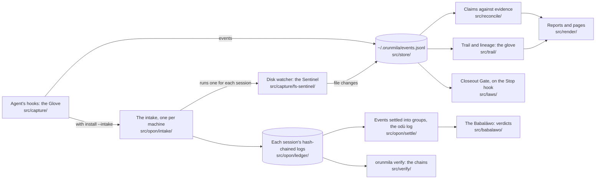

# Contributing to orunmila

Thanks for wanting to help. orunmila is small, dependency-free, and deliberately
honest about its limits — contributions that keep it that way are very welcome.

This page is the way in for people who want to change the code: your first
hour, a map of the system, the rules, and the gates a change must pass. What the
tool does for its users is in the [README](README.md) and the
[guide](docs/GUIDE.md).

## Your first hour

```bash
git clone https://github.com/kalkudiary-ai/orunmila.git
cd orunmila
npm test                        # every suite, each in its own process; needs nothing installed
node bin/orunmila.js demo       # writes orunmila-demo.html: open it to see what a user sees
```

Then follow one event through the system, in this order:

1. A hook fires: `src/capture/claude-code/post-tool-use.js` reads the agent's
   payload and hands it to `src/capture/core.js`, which writes one event.
2. The event lands in `~/.orunmila/events.jsonl` through `src/store/eventlog.js`,
   the flat log everything else reads.
3. At the end of a turn, `src/reconcile/index.js` sets the agent's claims beside
   the turn's events and the Sentinel's disk changes, and gives each claim an
   outcome (`verified`, `phantom` and the rest).
4. `src/render/` draws it: the terminal report, and the trail page
   (`orunmila trail`).

Run one suite on its own while you work: `node test/graph2d.js`. Each suite is a
plain Node script; `test/all.js` lists them, so a new suite is added there.

## A map of the system

Two witnesses, side by side, at every step: the **Glove** (the agent's own
hooks) and the **Sentinel** (a disk watcher the agent does not drive).



| Folder | What lives there |
|---|---|
| `bin/` | `orunmila.js`, the command line; every command starts here. `dashboard.js`, a local web page over the log |
| `src/capture/` | The Glove: one adapter per agent (`agents.js`), the shared capture engine (`core.js`), Claude Code's hook scripts, and the Sentinel (`fs-sentinel/`). Observe-only: it never refuses and always exits 0 |
| `src/store/` | The flat event log (`eventlog.js`), secret redaction (`secrets.js`), and the reader for older logs |
| `src/reconcile/` | Claim and request extraction (fixed rules, no model) and the matcher that gives each claim its outcome |
| `src/trail/` | The complete trail of a session (the glove) and its read-to-write lineage |
| `src/laws/` | The Closeout Gate: the six laws, how a claim is read, what counts as proof, and the Stop hook's answer |
| `src/opon/` | The intake (`intake/`), each session's hash-chained logs (`ledger/`), the engine that settles events into groups (`settle/`), and replay |
| `src/babalawo/` | The judge: its rules, its verdicts, the session report |
| `src/verify/` | The hash chain and the record schemas `orunmila verify` checks |
| `src/render/` | Every page and report: terminal, HTML, the trail page and its Graph and 3D Map |
| `src/runtime/` | Install, the one fixed starter every hook runs, and the update check |
| `src/stats/` | `orunmila stats`, comparing agents across sessions |
| `src/feedback/` | `orunmila feedback`, turning a user's sessions into accuracy cases |
| `src/demo/` | The scripted session `orunmila demo` renders |
| `spec/` | The JSON schemas of every record, and the hash chain's spec |
| `test/` | Every suite, and the labelled cases in `test/cases/` |
| `scripts/` | Tools for working on Orunmila: the mutation gate, the browser check of the trail page, benchmarks. Not in the package |
| `docs/` | The guide, the measurement write-up, the JSON schema, the design history |
| `review/` | The issue tracker (`review/ISSUES.md`, as of 2026-10-28) and the design notes |

## Ground rules

- **Zero runtime dependencies.** The `dependencies` field in `package.json` stays
  empty. Dev-only tooling (the test runner is hand-rolled, `c8` for coverage,
  `eslint`/`prettier`) is fine; a runtime dependency is almost never the right
  answer here and a PR that adds one needs a strong, specific reason.
- **Node 18+ only, no transpile step.** Plain CommonJS, no build. If it doesn't
  run on a clean `node 18`, it doesn't ship. Code here is JavaScript.
- **Windows, Linux and macOS.** CI runs every suite on all three, on Node 18, 20
  and 22. Build paths with `path.join`, never assume `/`, and say in a PR what
  differs by OS.
- **Local-first and private by default.** Orunmila's work makes no network call
  and needs no account or API key. Its one call is the update check
  (`orunmila update`, and once a day after `orunmila install` unless turned
  off), which sends only the package's name. Don't add another, don't add
  telemetry, and never send a user's session data off their machine.
- **No AI model judges anything.** Every outcome and verdict is fixed code over
  the record.
- **Honest over impressive.** Every heuristic in this codebase is labelled as a
  heuristic where the user can see it (the turn-scoped lineage, the sentinel
  time-window). Keep that contract: surface a failure mode, don't hide it.

## The quality gates

These are the bars CI enforces (`.github/workflows/ci.yml`). Run them locally
before opening a PR:

```bash
npm test              # all suites, every one in its own process
npm run coverage      # c8 with the thresholds in .c8rc.json (fails under them)
npm run accuracy:gate # detection accuracy must stay >= 95% with the sentinel on
npm run lint          # eslint flat config
```

A test is only trusted once you have seen it fail: write it, watch it fail on
the old code, then make it pass. `npm run mutation:gate` breaks the code on
purpose, one small change at a time (`scripts/mutation-gate.js` lists each), and
fails if no test notices; add an entry there for new behaviour.

**A note on "95%".** The accuracy gate measures **detection accuracy** — how
often the reconciler reaches the right verdict on a labelled fixture — *not* test
coverage. Please don't game either number. Padding line coverage with tests that
assert nothing, or tuning the accuracy fixtures to flatter the tool, defeats the
entire point of a tool whose job is to catch exactly that kind of thing. If a
real improvement lowers a metric, say so in the PR and we'll talk about it.

## Adding an agent (the most wanted contribution)

orunmila is agent-agnostic by design. Supporting a new agent (Zed, Windsurf,
whatever) is usually a **registry entry, not a code fork**, and testing an
experimental one (Cursor, Gemini CLI, Codex, Continue) on real sessions is just as
wanted:

1. Add an entry to the `REGISTRY` in `src/capture/agents.js` — its id, where its
   hook config lives, the event names it uses per lifecycle phase, and any tool
   names the defaults don't already cover.
2. `node bin/orunmila.js install --agent <id>` and run a real session.
3. If claim extraction comes back empty, `orunmila debug-transcript <path>` shows
   why; most agents need no transcript module of their own.

See [Architecture: how agent-agnostic works](docs/GUIDE.md#architecture-how-agent-agnostic-works)
in the guide.

## Sharpening the heuristics

The single most valuable code contribution is improving claim/subtask extraction
(`src/reconcile/claim-extractor.js`, `task-extractor.js`) **without** adding paid
API calls. Issues are tracked with their status in `review/ISSUES.md` (as of
2026-10-28; findings since are in `CHANGELOG.md`); the accuracy fixtures live in `test/cases/`, and the
real-log-derived negative corpus (the false-positive guard) in
`test/cases/precision/`. Add a fixture that reproduces a
mis-detection, then fix it — that's the ideal PR shape.

## Pull request checklist

- [ ] `npm test`, `npm run coverage`, `npm run accuracy:gate`, and `npm run lint`
      all pass locally.
- [ ] New behaviour has a test you saw fail first (and a labelled fixture if it
      changes a verdict).
- [ ] No new runtime dependency; no new network call (the update check is the only one).
- [ ] Any new heuristic is labelled as one where the user can see it.
- [ ] What differs on Windows, Linux and macOS is said.
- [ ] `CHANGELOG.md` has an `Unreleased` entry describing the change.

## Reporting bugs

Open an issue with the smallest reproduction you can. For a detection bug, the
most useful thing is the offending claim/prompt text and what you expected the
verdict to be — that maps straight onto a fixture in `test/cases/`.

By contributing, you agree your contributions are licensed under the project's
Apache License 2.0.
