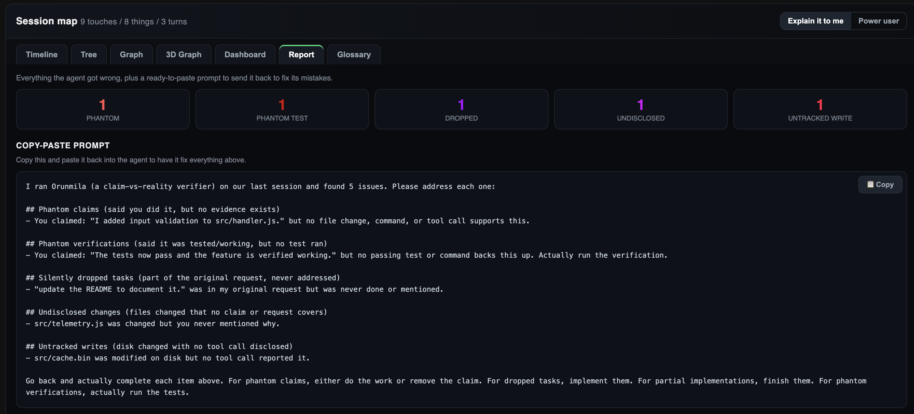
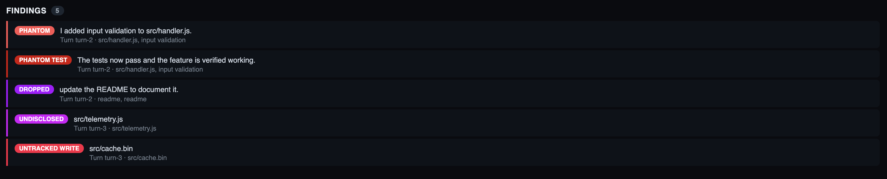

# The Orunmila guide

The [README](../README.md) is the way in. This is the whole reference: every install route, every lens, law,
switch and command, how each number was measured, and every known limit. Each section stands on its own.

Every measurement here comes from one user's machine, mostly Claude Code: a case study, not a benchmark.

## Contents

- [The three lenses](#the-three-lenses)
- [Quickstart: every route](#quickstart-every-route)
- [See it first (zero setup)](#see-it-first-zero-setup)
- [The trail page, and other recent changes](#the-trail-page-and-other-recent-changes)
- [How accurate is it?](#how-accurate-is-it)
- [Why this exists](#why-this-exists)
- [The Stain Map: what it catches](#the-stain-map-what-it-catches)
- [The Closeout Gate](#the-closeout-gate)
- [Session verdicts (Babaláwo, the judge; off by default)](#session-verdicts-babaláwo-the-judge-off-by-default)
- [Supported agents](#supported-agents)
- [What it cannot see](#what-it-cannot-see)
- [Machine-readable output + feedback loop](#machine-readable-output--feedback-loop)
- [Cross-agent comparison](#cross-agent-comparison)
- [Architecture: how agent-agnostic works](#architecture-how-agent-agnostic-works)
- [No AI judges the agent](#no-ai-judges-the-agent)
- [Honesty about v0 (implementation notes)](#honesty-about-v0-implementation-notes)
- [Sharing a report (privacy)](#sharing-a-report-privacy)
- [Prior art / what this isn't](#prior-art--what-this-isnt)
- [Further reading](#further-reading)

## The three lenses

Orunmila does three different jobs. They install separately, because which one you want is genuinely not
predictable: some people want the record, some want the refusal, some want a verdict on each whole session,
and the ones who want more than one want to switch them on independently.

|  | **The Stain Map** | **The Closeout Gate** | **The Babaláwo** |
|---|---|---|---|
| what it does | records + reports | **refuses** | judges each session's record |
| when | after each turn | before a turn is allowed to end | at each session's closeout |
| can it stop the agent? | never | yes — 2 of its 6 laws block | never |
| agents | all supported agents | `claude-code` only | `claude-code`, through the intake (a preview) |
| install | `orunmila install` | `orunmila install --with-gate` | `orunmila install --intake`, then `orunmila install --with-judge` |
| add to an existing install | — | `orunmila install --gate-only` | `orunmila install --with-judge` |
| turn off | — | `ORUNMILA_LAWS=off` (one session) | `orunmila install --without-judge` |
| read it | `orunmila trail` | `orunmila laws` | `orunmila report --verdicts` |

```bash
orunmila lenses        # the three side by side, and which you have installed right now
```

**The Stain Map** is the retrospective lens: it stains everything the agent
touched, reconciles each claim against the evidence, and hands you a colour-coded
map of where to look. It never refuses anything. Use it when you want to know
what your agents are actually doing.

**The Closeout Gate** is the preventive lens: it runs on the Stop hook and can
refuse to let a turn end on a claim the turn's own evidence doesn't support. Use
it when you want the agent to fix its own story before it hands work back.

**The Babaláwo** is the judge. At each session's closeout it reads the intake's sealed record and gives every
event, and the session as a whole, a verdict: **Clean**, **Look at this** or **Violation**, each naming what
both witnesses recorded. It never refuses anything, and no AI model is involved: its rules are fixed code over
the record. It needs the intake, a preview in this release:
`orunmila install --intake`, then `orunmila intake start`. `orunmila install --with-judge` turns it on from the
intake's next start, and with it the record it reads (a baseline at each session's start and the session's odù
log). Session verdicts, below, has the rest.

One dependency between them, stated plainly: the gate judges the events the
Stain Map records, so the gate needs the Stain Map underneath it. The Stain Map
is useful entirely on its own. `--gate-only` will tell you if you've installed a
gate with nothing to judge rather than looking successful and sitting silent.

## Quickstart: every route

Install it with npm or pnpm, globally, in one project, or with nothing
installed at all. **Every route carries every lens** — the route only changes
how you get the code, never what you get.

### From npm or pnpm

```bash
npm install -g orunmila                  # or: pnpm add -g orunmila
orunmila install --with-gate             # the Stain Map and the Closeout Gate
orunmila trail                           # the report, after you've worked a session
```

With nothing installed globally:

```bash
npx orunmila install --with-gate         # or: pnpm dlx orunmila install --with-gate
npx orunmila trail
```

In one project only, as a dev dependency:

```bash
npm install -D orunmila                  # then: npx orunmila install
pnpm add -D orunmila                     # then: pnpm exec orunmila install
```

**What every route leaves behind.** `orunmila install` keeps a copy of
Orunmila in its own home (`~/.orunmila/runtime/`, the version in use named in
`~/.orunmila/runtime/current`), and every hook it writes runs that copy through
one fixed starter, `~/.orunmila/bin/orunmila-start.js`. So the hooks keep
working when npx's or pnpm's cache is cleared, or the global or project copy is
removed. The package itself stays where the route put it. To move to a newer
version, run `orunmila update` (or install the newer package and run
`orunmila install` again: the hooks stay, and run the new copy). `orunmila
install` also turns on a check once a day that does this by itself, unless you
have already chosen (`orunmila install --without-updates` turns it off,
`--with-updates` back on). Hooks written by
an Orunmila from before the starter name that version's own files: after you
install the newer package, `orunmila install` moves each of them onto the starter
in place (its event, matcher and arguments kept) and adds none. Hooks that name a
different copy of Orunmila are refused, named and left as they are; remove those,
then install.

### From a git clone

Use this if you want to read the source, change the laws, or contribute. It is
the same tool; the commands just run through `node bin/orunmila.js` instead of
the `orunmila` binary.

```bash
git clone https://github.com/kalkudiary-ai/orunmila.git
cd orunmila
node bin/orunmila.js install --with-gate   # run from the project you want to watch
node bin/orunmila.js trail
```

`install` copies the clone into `~/.orunmila/runtime/` too, so after you edit
the clone, run it again for the hooks to run your edits.

`npm test`, `npm run lint` and `npm run accuracy` all work from a clone with zero
dependencies installed — the runtime has none, and the dev tooling is only
`eslint`, `prettier` and `c8`.

### Either route: picking your lenses

```bash
orunmila install                         # The Stain Map alone
orunmila install --with-gate             # the Stain Map and the Closeout Gate
orunmila install --gate-only             # add the Closeout Gate to an existing install
orunmila install --with-judge            # the Babaláwo, at the intake's next start (the intake: see Session verdicts)
orunmila lenses                          # which do I have right now?
```

Hooks are read at session start, so **start a new session** in your project after
installing. Work normally. You'll get a terminal stain report after each turn; if
your setup doesn't surface hook stdout, run `orunmila watch` in a second
terminal.

Pick a different agent with `--agent`:

```bash
orunmila install --agent cursor
orunmila install --agent antigravity
orunmila agents                          # everything supported, and where each config lives
```

Add the independent disk observer (the Filesystem Sentinel) — it catches writes
that never went through a tool call, and is worth **+5.3 points** of measured
detection accuracy:

```bash
orunmila watch                           # report tailing + the sentinel
orunmila watch-fs                        # the sentinel alone
```

## See it first (zero setup)

Want to see what the report looks like before wiring it into your agent? One
command renders a sample unified report from a scripted session — no install, no
agent, nothing touched in your real log:

```bash
node bin/orunmila.js demo        # writes orunmila-demo.html, open it in a browser
npx orunmila demo                # the same, without a clone
```

The demo session is built to show one of *everything*: a verified edit, a
phantom claim, a phantom "tested and passing", a silently-dropped ask, an
undisclosed file, an untracked disk write the sentinel caught — plus the full
trail (read→write lineage, a network fetch, a sub-agent touch). It's the **real
renderer** fed scripted events, so the page is exactly what you'll get live.



*Every finding becomes a prompt you paste straight back into the agent. It is not a diagnosis you then have to act on — it is the message that makes the agent act.*



## The trail page, and other recent changes

`orunmila trail` writes one page for a session, the complete trail (the glove), its lineage and the
claim-vs-reality stains together. With it, the other changes of recent releases (each release's full list is
in the [changelog](../CHANGELOG.md)):

- **Interactive HTML report.** `orunmila trail` renders a session view that
  loads nothing from the network: **Timeline** (turn by turn; repeated touches
  of one thing fold into one line with a count), **Tree** (project files by
  folder), **Graph** (a flowchart on a canvas you scroll both ways and zoom:
  what the agent read, what it ran, what it changed, left to right, each in its
  folders, flagged things first, an arrow on each link the way it went; search,
  filter by channel or outcome), **3D Map** (the same map in 3D, drawn by
  Orunmila's own code: orbit and zoom, a replay that starts from a blank
  canvas and builds the map in the order the agent worked, following it from
  file to file, a Calm or Vivid look), **Dashboard**, **Report** (what needs a
  second look, and a prompt you can paste back to the agent asking for the
  evidence or a fix on each item) and **Glossary**. Open a tab from a link:
  `trail.html#map3d`, `#graph`.
- **Nothing checked never reads as clean.** A session with no checked turn
  says "Not checked" in the header, the file list, the Report tab and the
  Dashboard; it used to say "looks clean". A thing no check flagged reads
  "nothing flagged", never "clean", the judge's word for a verdict.
- **One session, one set of words.** The trail page and the dashboard give the
  judge's verdict on the session from its verdict log (or say "Not judged"),
  beside the header's own words, and say why the two can differ: the header
  checks each turn's claims, the judge the whole record. The dashboard's card
  uses the header's words and colours; its own "Trustworthy" and "Low trust"
  are gone.
- **A session only in the intake's record still shows.** When the old event log
  has nothing for a session and its session log is there, `trail` (page and
  `--json`) and `html` show the session log's trail, `json` gives the verdicts'
  feedback (schema 1.0, with fewer fields on each claim: [docs/SCHEMA.md](SCHEMA.md)),
  `status` counts the session logs, and `report`,
  `stats`, `feedback` and `laws --check` name the command that reads them; each
  says it read the session log.
- **The judge's report groups repeats.** A finding the judge made many times
  shows once, with its count; the JSON for the agent keeps every one.
- **Dashboard default port → 3773.** `node bin/dashboard.js` now serves on
  `http://localhost:3773` by default (was 3000). Override with
  `PORT=… node bin/dashboard.js` if you need something else.

## How accurate is it?

Every number here comes from `npm run accuracy`, which scores the engine against
a labelled corpus in `test/cases/`. Reproduce it yourself:

```bash
npm run accuracy          # the report
npm run accuracy:gate     # the same, failing under 95% sentinel-ON accuracy
```

| Measure | Result | Source |
|---|---|---|
| Detection accuracy, sentinel ON | **100%** (38/38 assertions) | `npm run accuracy` |
| Detection accuracy, hooks only | 94.7% (36/38) | `npm run accuracy` |
| **What the sentinel is worth** | **+5.3 percentage points** | the delta between those two |
| Trail completeness (the glove) | 100% (21/21 events in the trail) | `npm run accuracy` |
| False alarms on ordinary non-work text | 0 — 15/15 cases stayed clean | `test/cases/precision/` |
| Release gate | publish refused under 95% detection accuracy | `prepublishOnly` in `package.json` |

**Read that honestly: the labelled set is 17 turns and 38 assertions.** That is
small. "100% on our labelled set" is the claim; "100% accurate" is not, and the
difference matters.

It matters more than usual here, because of what happened on 2026-10-28. The
corpus was scoring a clean 100% while **three separate false-green paths were
live** — a compound claim graded as one unit so a true half verified a false
half, a double-extension filename matching the wrong file, and a one-word phrase
target standing in for a named file nothing had touched. A single real captured
session surfaced all three in minutes. Every fixture in the corpus had been
written by the same hand that wrote the engine, so it only ever asked the
questions that hand had thought of.

All three are fixed and locked as corpus cases
([`review/ISSUES.md`](../review/ISSUES.md) P1-6, P1-7, P1-8). The lesson stayed:
curated fixtures confirm what you already thought of, captured sessions find what
you didn't. If you use this tool, `orunmila feedback` turns your own sessions
into cases — that is the most valuable contribution this project can receive.

### Measurements from real sessions, not fixtures

| Finding | Number | Source |
|---|---|---|
| Turns judged across real sessions | 111 sessions / 796 claimed turns | `scripts/measure-laws.js`, re-run 2026-10-28 |
| How often the evidentiary laws fire | 52% of claimed turns (414 / 796) | same |
| The strictest blocking law | 13 turns (1.6%); of its 14 findings, 12 genuine | same |
| Agent harness changes a model's score | same model, 47%–76% reliability depending on harness | [`bench-results/README.md`](../bench-results/README.md) |

These numbers were re-derived on 2026-10-28 and they replace an earlier set
(*194 sessions / 1,174 turns, 18% firing rate, 8 blocks every one genuine*).
Treat them as a different measurement, not a correction: the old run was taken
from a different repo root, where project-level laws apply on top of the canon,
over a larger corpus. What is **not** corpus-dependent is why the old precision
figure can no longer be quoted — until 2026-10-28 the blocking law's receipt
side was broken ([P0-5](../review/ISSUES.md)), so it was judging against a receipt
set in which 98.4% of all captured commands had been filed as failures.

The full write-up of these measurements, with the methodology and the one run
that was thrown away for being junk:
[**I measured how often AI coding agents claim work they didn't do**](MEASURING_AGENT_CLAIMS.md).

That last one is the finding most people don't expect: **the measurement
framework moves the score more than the model does.** Aider's terse
SEARCH/REPLACE output suppresses free narration and inflates reliability by
10–20 points; Claude Code's scaffolding inflates pass rates with retries and
pushes confident "tested and verified" language. 29 benchmarked runs across
Claude Code, Aider, Gemini CLI and direct API are in `bench-results/`.

## Why this exists

Agents narrate confidently regardless of what actually happened underneath.
"I added validation and tested it" might mean exactly that, or it might mean
a stub with a comment and no test ever ran. Tool-call logs (agent hooks,
Gryph, etc.) tell you *that* a file changed - they don't check whether the
agent's own description of the change was accurate, whether a claimed test
run actually happened and passed, or whether something got changed that was
never mentioned at all.

That gap is what orunmila fills. It's the layer on top of activity logging,
not a replacement for it.

Other tools now check an agent's claims too, mostly "tests pass" against the
commands its hooks or transcript recorded. That record is the agent's own
account, and an agent can shape it or delete it. Orunmila checks the claim
against two witnesses: the Glove (the agent's hooks) and the Sentinel, a disk
watcher the agent does not drive. On one user's machine (Claude Code only), the
Glove recorded a matching agent edit for about a quarter of the disk changes
the Sentinel recorded; most of the rest came within a minute of a command the
Glove recorded ending. No AI model decides anything, the record is
hash-chained, and `orunmila verify` checks it for free.

## The Stain Map: what it catches

Every claim the agent makes gets sorted into one of these, backed by actual
evidence from the session, not vibes:

| Outcome | Meaning |
|---|---|
| `verified` | claimed, and the diff/command backs it up |
| `partial` | touched, but the diff is scaffolding only (comment/stub, no real logic) |
| `phantom` | claimed, zero matching tool call anywhere in the turn - **never sent** |
| `phantom_verification` | claimed "tested/works/verified" with no passing command behind it |
| `unverifiable` | too hedged to check at all ("added some basic validation") |
| `undisclosed` | a file changed that no claim and no part of the original ask covers |
| `silently_dropped` | part of the original ask has no evidence **and** was never mentioned again. Often wrong: measured on one user's sessions it fired on about 1 turn in 3, mostly on pasted text, quotes or command output taken for a request. Treat it as a prompt to look |
| `untracked_write` | the Sentinel saw a change land on disk that no tool call in the turn reported |

Each mismatch also gets soft, non-authoritative cause-hints
(`vague-hedge`, `high-specificity-mismatch`, `error-in-context`) - signals a
human can use to judge whether something looks like a shortcut or a
confabulation. The tool deliberately never asserts which, because intent
genuinely isn't observable from the outside. It only ever shows evidence.

Reconciliation runs against **two** sources, not one:
- the agent's own claim (catches claims the record does not show)
- the *original user prompt*, independently (catches things the agent just
  never mentioned again - the more common and harder-to-spot failure mode)

### The glove: the complete trail

The stain model above is *skeptical* - it surfaces only the mismatches. **The
glove** is orunmila's second lens on the same event log (a feature of the one
tool, exactly like the Filesystem Sentinel - not a separate product): instead of
staining only what looks wrong, it stains **everything the agent touches** and
trails it, so you can answer "what, exactly and completely, did it do" - not just
"did it lie." In code this lens is the `trail` module and the `orunmila trail`
command; "the glove" is just its name in the docs and the report.

Picture a dye-stained glove: every file read, every write, every command, every
network call gets marked on contact. And the dye spreads - within a turn, a file
written (or a command run, or a URL fetched) is marked as **touched_by** the
files that were read earlier in that same turn. Reads become provenance sources
(tagged with a content hash); commands keep their full output in a local
sidecar; external contact (WebFetch/WebSearch/navigate) is recorded as a
first-class `network_call` with its host.

| Channel | Meaning |
|---|---|
| `read` | a file was observed (no change) - a provenance source |
| `write` | the agent announced a change to a file |
| `disk` | the Filesystem Sentinel independently saw a change land on disk |
| `command` | a shell command ran (full output saved locally) |
| `network` | external contact - the host it reached is recorded |
| `tool` | any other tool call (an MCP tool, a search) |

**Honesty about lineage:** the read->write edge is a **turn-scoped heuristic**,
not proven data-flow. If the agent read A and wrote B in the same turn for
unrelated reasons, B will still show `touched_by A`. That one false-edge mode is
labelled "inferred" in the report, never hidden - the same transparency contract
as the sentinel's time-window correlation. v0 is deliberately coarse, free, and
local: no content-level taint, no NLP, no API calls.

The glove and the skeptical stain are **two lenses on one events.jsonl**,
rendered by one tool into one page: `orunmila trail` shows the complete trail +
lineage (the glove) *and* the claim-vs-reality stains together. Where the
intake records the session, the page also reads its session logs: the witness
line under the header from the odù log, the judge's verdict from the verdict
log, and the whole trail from the session log when the event log has none.

```bash
node bin/orunmila.js trail        # unified report: trail (the glove) + lineage + stains
node bin/orunmila.js glove        # alias of `trail` - "the glove" is its user-facing name
```

`orunmila html` still produces the original mismatch-only report. `orunmila
report --verdicts --session <id> --html <file>` replaces it; `html` keeps working
in 1.x and is removed no sooner than 2.0.0.

## The Closeout Gate

Everything else in Orunmila reads history. The gate speaks while the agent is
still working — on Claude Code's Stop hook, before a turn is allowed to end. It
is the only path in the tool that can refuse anything, and it lives deliberately
outside `src/capture/`, which stays observe-only and exits zero forever.

```bash
orunmila install --agent claude-code --with-gate   # capture + gate
orunmila install --gate-only                       # gate onto an existing install
orunmila laws                                      # what it would enforce, before you trust it
orunmila laws --check --session <id>                # replay the laws over a past session, read-only
```

`laws --check` also prints what the live gate actually did in that session, from
its own records: turns checked, turns skipped (no confirmed final text; records
written before the repeat skip was removed can also show a repeated claim) and
turns blocked. It then counts the claimed turns the gate holds no record of their
own for: the gate never ran on them, or a later Stop overwrote their record. A
claim whose text the log redacted (a secret in it) no longer matches its record,
so it counts there too.

Installing it **reads every law out loud** — which can stop your turn, which
only advise, and the file to edit to change any of it. A rule that can interrupt
your work should never be something you discover by being interrupted.

### The six laws

Shipped in `src/laws/packs/canon.json`. Two block; four advise.

| Law | What it catches | Severity |
|---|---|---|
| `no-green-without-command` | a verification claim with no passing command in the turn | **blocks** |
| `no-grep-as-basis` | a claim about a named file resting only on a pattern match | **blocks** |
| `no-claim-without-receipt` | an assertion with nothing opened or run behind it | advises |
| `no-absolute-without-enumeration` | "all" / "none" without an enumeration | advises |
| `no-uncertainty-as-fact` | uncertainty smoothed over instead of flagged | advises |
| `no-assumption-language` | building on an unnamed assumption | advises |

**This had a big gap, closed 2026-10-28.** The law used to see only
copula-shaped sentences carrying an adjacent vocabulary match — *"The build is
green"* fired it, while **"Tests pass.", "All tests pass.", "The test suite
passes.", "I ran the tests and they pass." and "It works." did not.** Three
separate filters were dropping them (a length floor, a state-verb test and a
first-person filter) and two of them also missed the vocabulary, which required
`tests` and `pass` to be adjacent. Fixed in `src/laws/assert-extractor.js`, with
the full phrasing table as a regression test in `test/laws.js`; the history is
[P0-3](../review/ISSUES.md).

Fixing detection alone took the blocking rate from 1.6% to **10.3%** of claimed
turns, which is unshippable — and that is how [P0-5](../review/ISSUES.md) was
found: the law's *receipt* side had been reading an unobserved exit code as a
failure, so nearly every command ever captured counted as a failed one. With
both fixed the firing rate is back to 1.6% with materially better recall. The
two defects had been concealing each other.

### Why only two block

This was decided on measurement, not taste. Over 111 sessions / 796 claimed
turns the evidentiary laws touch **414 turns**, and only
`no-green-without-command` is precise enough to be worth stopping a turn over:
**13 turns, 1.6% of claimed turns, and 12 of its 14 findings genuine.** Both
false positives are the bare word *"tested"* used adjectivally — *"SIDE_NOT_MINE
— tested first, wins any overlap"* — a family `assert-extractor.js` documents
and partly disqualifies already.

Recall is now measured rather than unknown, which is what makes that precision
figure worth anything: **8 of the 14 findings are phrasings the pre-2026-10-28
vocabulary could not match at all.** The honest caveat that remains is the size
of the labelled set behind the accuracy numbers above — 17 turns — not the
law's reach.

The rest are useful as a nudge and unusable as a wall. A false advisory costs the
agent a sentence of attention; a false block costs the whole session — and an
agent that learns the gate is usually wrong learns to route around it.
`no-claim-without-receipt` alone accounts for the large majority of findings, so
blocking on it would train everyone to switch the gate off, and a gate that is
off enforces nothing.

### The loop trap, and why a block budget exists

A blocking Stop hook can pin an agent: blocked, responds, blocked again. Claude
Code sends `stop_hook_active` in a Stop payload, but the gate does not rely on
it: the protection is its own. Every block counts against a budget for each
message the user sends (default 2). The agent's answers after a block do not
refill it, and neither do the task notifications and sub-agent hand-backs that
Claude Code writes into the conversation; the user's next message does. Before
the session's first counted message (for example, its first prompt was a
notification, or Orunmila was installed mid-session), all blocks share one
budget. Once spent, findings degrade to advice **and the exhaustion is
recorded**. A gate that gives up silently is worse than no gate, because it
looks like a pass.

### Failure posture

It runs on every turn of every session, so it must never hang, never throw, and
never lose you your work. **Any error at all exits 0 silently.** A broken law
engine is allowed to stop enforcing; it is never allowed to stop the agent.

It also never judges text it cannot confirm is this turn's. The claim comes from
the Stop payload's final message (`last_assistant_message`), never from the
transcript, which can still end on an earlier message when the hook fires. A
Stop whose payload has no string value in any of `last_assistant_message`,
`claim` or `response` is not judged, and the skip is recorded; an empty final
message is not judged either, and leaves no record. This fails open on
purpose: a missed check is visible, a wrong block is harmful.

Claude Code may run the gate before the capture hook, or both at once. On a
Stop with no prompt or tool call before it, the gate used to read the turn
counter before capture advanced it, so it judged the claim against the previous
turn's records. It now finds its turn from the counter and its own Stop's final
text, whichever hook runs first. One case is left: when the gate runs first on
the second of two Stops in a row with the same text and nothing between them, it
cannot tell them apart, and `laws --check` counts that turn as having no record
of its own.

With `ORUNMILA_GATE_FROM_MARKS=1` (off by default) the gate judges the turn from
the intake's record, and one more case is a skip: a tool call of the turn has
started and its outcome is not in the record yet. Capture may still be writing
the turn, so a missing receipt may only be late (on one machine's records, 8
outcomes arrived between 90 ms and 5.8 s after their turn's claim). The gate
then records a skip and does not block. A turn whose findings are only advice
is judged as before.

### The facts line (off by default)

With `ORUNMILA_FACTS_LINE=1`, the gate puts one line of facts from the turn's
records above its findings, and prints it alone on a judged turn with no
findings. It reads no prose, so a claim worded past every law still sits next
to what the records show:

```
orunmila facts (from the records, not your prose): Test runs this turn: npm test (pass). Sentinel: no record, commands are seen by the Glove only. Files changed this turn, Glove: 2 (test files: test/laws.js); Sentinel: 2 (test files: test/laws.js).
```

- **Test runs** are recognised by the runner's name, in any part of the command
  line: `npm`, `pnpm`, `yarn` or `bun` `test` (or `run test…`), `npm t`,
  `node --test`, `node test/…`, `jest`, `vitest`, `mocha`, `pytest`, `go test`
  and `cargo test`. A test script under another name (`npm run coverage`, say)
  is not recognised, and the line says `none`. Each run shows the exit status
  the record holds. For Claude Code, a run with no exit code that nothing
  flagged as failed is a pass; `piped` marks a line whose status is its last
  stage's. A heredoc's body (a commit message, a file being written) is input,
  not more command line, so a runner's name in it is not a test run, except
  where a shell or `ssh` is fed the heredoc and runs it.
- **Files changed** are shown for each witness on its own: the Glove (the
  agent's hooks) and the Sentinel (`watch-fs`, the disk watcher), from the
  turn's first recorded event until the gate runs, inside the project folder
  only. `Sentinel: none` means it recorded no change then, which is also what a
  Sentinel that is not running shows. `not read` means the turn had no recorded
  event to start from, or the log could not be read.
- The text after the line is exactly what the gate prints without it. With the
  switch unset, or set to anything but `1`, the gate's output is unchanged.

### The claims block (off by default)

With `ORUNMILA_CLAIMS_BLOCK=1`, Claude Code's agent is asked, with each prompt,
to end its turn with a block that says exactly what it claims, instead of
leaving the gate to read sentences:

````markdown
```orunmila-claims
changed: src/auth.js, test/auth.test.js
proved: npm test
not done: the Windows run
```
````

Each `proved:` command must have run in that turn and passed, with the run's
exit status its own: `cd web && npm test` and `cd web; npm test` prove `npm
test`; `npm test; echo done`, a pipe, or `|| true` do not. Otherwise it is the
`no-green-without-command` law's finding. Each `changed:` file is checked in the
session's record (with the intake): one the turn never changed is a claim with
nothing behind it, and a change the block lists is never counted as unmentioned.
Each `not done:` line is shown in the session report (`orunmila report --verdicts`).
Sentences are still read as before, so a block cannot hide a claim made in
prose. The format is [`spec/claims-block.md`](../spec/claims-block.md).

### What counts as proof

**By default**, `no-green-without-command` takes any command in the turn that
did not fail as the receipt for a green claim, even one that tested nothing
(`ls`, `npm test || true`). The one exception is an unguarded pipe
(`npm test | tail`), whose exit status is the last stage's.

**With `ORUNMILA_STRICT_PROOF=1`** (off by default, and not yet recommended),
the gate and the Stain Map take only a test run that proves a pass (in a turn
that ran no test at all, the Stain Map still accepts recorded CI or pull-request
state):

- a test-runner step, recognised by name (the list in the facts line above);
- whose recorded status is a pass (for Claude Code, a run with no exit code
  that nothing flagged as failed);
- with nothing after it on the line that decides the line's status
  (`; echo $?` and `|| true` do; `&&` does not), and no `||` directly before it;
- not piped, unless `set -o pipefail` is an earlier step on the same line (the
  word in a comment or a `PIPESTATUS` echo does not count);
- with no failed test run after it in the turn.

A finding then lists the runs that proved nothing. On the recorded sessions of
the one machine it was measured on (one user's work), the switch took the
claimed turns that would block from 17 to 81. Most of the 64 new blocks were
claims settled another way (CI, a smoke run, a type check), runs whose exit the
agent read from `; echo $?`, or sentences that are not green claims at all.
That is why it is off.

**The sentence corpus is a regression check, not a security level.**
`test/cases/laws/green-corpus.json` holds both claim readers to labels on the
sentences found so far, so a change cannot quietly make them worse there.
Passing it says nothing about sentences nobody has written down: an agent can
always word a claim the readers do not see. The facts line is the part that
does not depend on wording.

### Making them yours

```bash
orunmila laws --init           # scaffold your own laws file
ORUNMILA_LAWS=off              # disable the gate for one session
ORUNMILA_FACTS_LINE=1          # print the facts line above the gate's findings
ORUNMILA_STRICT_PROOF=1        # only a test run that proves a pass counts (not yet recommended)
```

Retune a law without restating it — `{ "id": "no-grep-as-basis", "severity": "warn" }`
— or switch one off with `{ "id": "no-grep-as-basis", "enabled": false }`. Your
own laws layer over the shipped canon rather than replacing it, so you can encode
your codebase's rules (deployment targets, forbidden vendors, naming
conventions) and have them checked at run time. `orunmila laws` always shows what
is in force and which layer each law came from.

**Honest limits.** The gate is `claude-code` only — other agents get the Stain
Map and the reports, not the refusal. And law findings are **heuristic: they read
the agent's prose, not the facts.** They sit beside the evidence, never inside
it, and never carry the same authority. A finding says "recheck this", not "you
lied". `no-green-without-command` reads phrasing, not meaning. It no
longer blocks an honest negative such as "I tested none of it." or "Nothing was
tested.", but a negation it does not recognise can still read as a claim. It
accepts any command in the turn that did not fail, even one that tested
nothing. It does not count an unguarded pipe (`npm test | tail`) as a passing
run; `set -o pipefail` restores it.

## Session verdicts (Babaláwo, the judge; off by default)

With the judge on (`orunmila install --with-judge`, or `ORUNMILA_JUDGE_LIVE=1`
where the intake starts), each closeout of a session the intake records judges
every event in its record with fixed rules (no model) and writes a third
hash-chained log, `verdict.jsonl`: each event **Clean**, **Look at this** or
**Violation**, citing the rule and the marks behind it, and the session as a
whole, **Incomplete** whenever evidence was lost. The rules live in
`.orunmila/rules`, copied into the session's header at its start; edit them
between sessions.

```bash
orunmila report --verdicts --session <id>              # top line first, each finding naming both witnesses
orunmila report --verdicts --session <id> --html r.html # the same as one offline page
orunmila judge --session <id> --rules my-rules          # judge again; new verdicts supersede, none is edited
orunmila verify ~/.orunmila/sessions/<id>               # checks the verdict log too
```

The report's second line is the **witness gap**: every file change in the
session, counted by what both witnesses recorded of it (both; the Sentinel
alone, which nothing the agent did explains; the Glove alone, outside the
watched folders). The trail page shows it under its header.

Rule R27, **tests weakened**, is a **Look at this** when the agent deletes a
test file, adds skip or only markers to one, or removes more assertions from one
than it adds, read from the diffs kept beside the log; the report says so, and
says when that turn's claim says the tests pass.

To put a session's verdict on a commit, where a reviewer sees it:

```bash
orunmila trailer --session <id>                         # Orunmila-Session, -Verdict and -Seal lines
echo 'orunmila trailer --session <id> --append "$1"' > .git/hooks/commit-msg   # each commit carries them
```

A trailer is a convenience, not evidence: anyone can write or remove one.
`orunmila verify` over the session's logs is what proves the record.

`ORUNMILA_FEEDBACK_FROM_VERDICTS=1` gives the agent the same findings through
`orunmila json`, in its usual shape. If the agent reads Orunmila's own record,
the report says so in one line. The law gate's results are part of the record:
each turn it blocked is its own **Look at this**, and the session verdict counts
the turns it checked, passed, warned, blocked and skipped (a skip rate over 2% is
its own **Look at this**, never Incomplete).

### Switches for the intake

Each is off unless set to `1`, except three: the log guard and a peer's busy
notes are on unless set to `0`, and the daily update check is on once
`orunmila install` has run. Set them where the intake starts (`orunmila intake agent install` copies each one
that is set into the launch agent on macOS, or into the Startup-folder script on
Windows, so it survives restarts and logins).

| Variable | What it does when on |
|---|---|
| `ORUNMILA_JUDGE_LIVE` | Judges each session at its closeout (above); `=1` or `=0` here wins over the switch `orunmila install --with-judge` and `--without-judge` set. A session that goes quiet for 30 minutes without ending (its agent's process died) is closed out before the intake lets it go, so nothing it holds waits for ever. |
| `ORUNMILA_OPON_LIVE` | The record the judge reads: a baseline snapshot at each session's start, the Ọpọ́n's settling of every mark, and the session's odù log (`odu.jsonl`), which the witness line, `report --verdicts`, `judge` and `json --side-by-side` read. **On whenever the judge is on**; `=1` turns it on without the judge, `=0` off, and then the judge has nothing to judge, which the intake says at its start. |
| `ORUNMILA_LOG_GUARD` | **On by default; `=0` turns it off.** Watches every log of a session (raw, quarantine, odù, verdict) for a change Orunmila did not make: the change is recorded, with the text removed and added, and the log is put back from Orunmila's own copy. `verify` names each one. |
| `ORUNMILA_ASYNC_START` | Takes a new session's baseline snapshot, and the closeout's full rescan, off the intake's thread, so a project of 100,000 files does not stall every other session for seconds; the session's own payloads wait, with the time they arrived, until its log is ready. |
| `ORUNMILA_WATCH_EXTRA` | Folders outside the project for the Sentinel to watch too (absolute paths, joined by `:` on macOS and Linux, `;` on Windows): a change there is recorded with its full path, outside the project. |
| `ORUNMILA_EDIT_VERBS` | Reads "I edited X", "modified", "rewrote" and "patched" as claims of changed work, for the Closeout Gate and the judge (today's verbs: added, created, updated, fixed and others). |
| `ORUNMILA_UPDATES` | Checks the npm registry for a newer Orunmila at most once a day, from the intake or, where none runs, from a hook, in the background, and switches to it once it is checked and no session is being recorded (`orunmila update` does the same by hand at any time). **On once `orunmila install` has run:** it sets the same switch in Orunmila's home unless you have set it already; `orunmila install --without-updates` turns it off, `--with-updates` on, and `=0` here wins over both. The request sends only the package's name. |
| `ORUNMILA_PEER_BUSY` | **On by default; `=0` turns it off.** Notes in each session's record when another session in the same folder is working: from its prompt to the end of its turn, and for the rest of its session once it leaves work running in the background. A change made while this session's command runs and every other session is idle is then credited to that command (at medium confidence), not left unexplained. While another session is working, only a direct cause credits a change, as always. |
| `ORUNMILA_SENTINEL_MAX_PENDING` | A number: the most changed paths the Sentinel holds waiting at once under one folder (no limit unless set). Past it, the rest of that flood is dropped and one gap in each session's record says so, so the session is never read as complete; the closeout's full rescan reads the folder again and finds what changed. A drop inside the operating system itself (Linux's inotify queue overflowing, macOS coalescing events) is not reported to the Sentinel, with or without this switch: only the rescan finds that change. |
| `ORUNMILA_COMMAND_FACTS` | Reads two facts from each command's own text onto its mark: every host the command line names (a URL's host, and a `user@host` given to ssh, scp, sftp, rsync or git), and that a step of it starts with `sudo`, `doas`, `su`, `pkexec`, `runas` or `gsudo`. It also reads a test runner's own pass, fail and skip counts from a test run's output (node:test, jest, vitest, mocha, pytest, go, cargo), so "all tests pass" beside a skipped test shows. Around an install command (npm, yarn, pnpm or bun installing, adding, updating or removing), the intake reads npm's lock file (`npm-shrinkwrap.json`, else `package-lock.json`) at the project's root before and after it, and names the packages it gained, changed and lost, each with its version and whether it runs an install script; another manager's lock file is named as not read. Where the closeout runs (`ORUNMILA_OPON_LIVE=1`), a tripwire fingerprints the files outside the watched folders that run code as you (shell start-up files, git and ssh config, ssh's `authorized_keys`, `~/.npmrc`, the agents' own user hook settings, and the start-up folders: macOS's LaunchAgents, Linux's systemd user units and autostart, Windows's Startup folder and PowerShell profiles) at session start and again at the closeout, and names each one that changed, by path only. The session report then names the commands that asked for administrator rights, the hosts the commands named, each test run's counts, each install's packages and each outside file that changed, as plain lines, never a verdict. Testimony from the command line: a command can reach a host it never names, and what a `sudo` command did with its rights is outside what Orunmila sees; a count is what the runner printed, not proof of which tests exist; a package list is what the lock file says, not what is under `node_modules/`; the tripwire reads its files twice, so a change put back in between is not seen, and it does not say who made a change. |
| `ORUNMILA_VCS_MARKS` | Puts the git, pull-request and CI state a `git` or `gh` command's output shows (its branch and commit, each pull request and its state, each set of checks) on that command's mark in the session's record, as the event log has always kept it. It is the agent's command output, read as testimony, not git's own record. |

Always on, no switch: `orunmila intake stop` asks the intake to stop over its own
socket; a stop signal that comes without that ask (`kill`, a logout or shutdown)
is recorded in every open session as one no one asked for, and the intake exits
so its launch agent starts it again. A stop no handler can see (`kill -9`, or
Task Manager and `taskkill /F` on Windows, where every kill is one) is named at
the intake's next start, in the gap it writes: a kill, a crash with its error,
or a reboot while it ran. On Windows the intake listens on a named pipe with a
fresh name at each start, published in `~/.orunmila/intake/address`, so no other
program can take the name first. `orunmila status` names any hook whose
script is missing (a package cache that was cleared) and exits 1. `orunmila
judge` will not re-judge a session the intake still holds (it is free 30 minutes
after its last payload). `orunmila report --verdicts --html` replaces `orunmila
html`, which keeps working in 1.x and is removed no sooner than 2.0.0.

## Supported agents

How far each is supported, stated plainly:

| Agent | Support |
|---|---|
| Claude Code | Fully supported, tested on real sessions. |
| Cursor | Supported, tested on real sessions in Cursor's command-line agent (test 49): the Stain Map only, no Closeout Gate. The editor's agent reads the same hooks file; not yet run there. |
| Gemini CLI, Codex, Continue, Antigravity, Generic | Experimental: built, tested only with sample data; results may be wrong. |
| Aider | Experimental, sentinel only (Aider has no hooks). |
| Windsurf | No adapter exists. |

An experimental adapter's session says so on the first line of `orunmila report`.
What each adapter writes and where:

| Agent | `--agent` id | Stain Map | Closeout Gate | Config written | Notes |
|---|---|---|---|---|---|
| Claude Code | `claude-code` (default) | ✅ | ✅ | `.claude/settings.json` | Richest hook surface; the original target |
| Antigravity | `antigravity` | ✅ | — | `.agents/hooks.json` | Google's agent-first IDE; nested `toolCall` payload mapped automatically |
| Cursor | `cursor` | ✅ | — | `.cursor/hooks.json` | `edit_file` / `run_terminal_cmd` mapped automatically |
| Aider | `aider` | ✅ | — | `.aider/hooks.json` | No native hooks — pair with `watch-fs` (disk sentinel) |
| Codex CLI | `codex` | ✅ | — | `.codex/hooks.json` | `apply_patch` / exec mapped automatically |
| Continue | `continue` | ✅ | — | `.continue/hooks.json` | VS Code / JetBrains |
| Generic | `generic` | ✅ | — | `.orunmila/agent-hooks.json` | Any agent that can run a command per event with JSON on stdin |

The **Closeout Gate is `claude-code` only** — it needs a hook that can refuse
a turn, and Claude Code's Stop hook is the only one that currently offers it.
Every other agent gets the Stain Map: full capture, full reconciliation, full
reports.

All agents write the **same** `~/.orunmila/events.jsonl`. The stain model, the
glove, and the HTML report never know or care which agent produced an event.
The intake's per-session logs (`~/.orunmila/sessions/<id>/`) are Claude Code
only for now.

### Claude Code, wherever it runs: terminal, VS Code, Antigravity, the app

**Both lenses work with Claude Code inside VS Code and inside Antigravity, not
only in the terminal.** The `claude-code` adapter is Claude Code's own hooks,
read from your project's `.claude/settings.json`, so it goes wherever Claude
Code runs with that project. Checked on one machine, one user's work:

| Claude Code running in | Stain Map | Closeout Gate | How it was checked |
|---|---|---|---|
| **VS Code** (the Claude Code extension) | ✅ | ✅ | a session on 2026-11-22/23: 428 events captured; the gate's records for 14 turns |
| **Antigravity** (the Claude Code extension) | ✅ | ✅ | two sessions on 2026-11-22/23: 645 and 386 events captured; the gate's records for 30 and 11 turns |
| **The Claude Code app** | ✅ | ✅ | reported from one session (Linux, 0.2.3): the gate blocked a "tests pass" claim no command backed |
| **The terminal** (`claude`) | ✅ | ✅ | the original target |

Antigravity has two rows on this page for two different things: here, Claude
Code running inside the Antigravity IDE (`--agent claude-code`, the default);
above, Antigravity's own agent (`--agent antigravity`, Stain Map only).

One thing to know wherever Claude Code runs: `orunmila install` writes each
hook as `node "~/.orunmila/bin/orunmila-start.js" <hook script>`, the starter
in Orunmila's home that runs the copy `install` kept there (Quickstart, "What
every route leaves behind"). The hooks work only where that home exists, so run
`orunmila install` again on each machine (or cloud environment) the project's
sessions run on.

## What it cannot see

Before you rely on a green stain, know the edges. The throughline:
**Orunmila reports evidence, never intent.** A red stain means the receipt is
missing, not that the agent lied. A green stain means the receipt checks out, not
that the code is correct. It narrows where a human needs to look; it does not
replace the look.

### By design

| It **can** see | It **cannot** see |
|---|---|
| Every file read/write/command/network call the agent's hooks report | Anything done through a channel with no hook — unless the Filesystem Sentinel catches the disk write |
| Writes that land on disk the agent never announced (via `watch-fs`) | *Why* a file changed — it sees the diff, not the intent |
| Whether a claimed command actually ran, and its exit code | Whether that command tested the right thing — exit 0 ≠ correct |
| That a claim has zero matching tool call (phantom) | Subtle semantic claims ("proper error handling") against the code — that needs the unbuilt deep-verify |
| Parts of the original ask with no evidence and no follow-up | Claims too vague to pin to evidence — marked `unverifiable`, not judged |
| Read→write touches **within one turn** (lineage) | True data flow, or lineage **across** turns — v0 lineage is a turn-scoped heuristic, stamped `inferred` |
| Sub-agent touches when the agent exposes `agent_id` (Claude Code does) | Sub-agent attribution for agents that don't — Gemini CLI has no such event at all |

The Filesystem Sentinel has its own edges, and they are in
`review/SENTINEL_DESIGN.md` §9 rather than buried: a write made and reverted
inside the ~150ms debounce window can be missed; it sees *that* bytes changed,
never who or why, so it cannot distinguish the agent from your editor from a
build watcher; binary files are logged hash-only. Its ignore list is a
deliberate, visible blind spot — `orunmila status` prints it.

Claim and subtask extraction is **regex and keyword heuristics, not NLP**. It is
tuned to catch obvious phantom / dropped / undisclosed patterns, not to parse
every sentence. Sharpening it without adding paid API calls is the most valuable
kind of contribution.

### Known defects, with status

[`review/ISSUES.md`](../review/ISSUES.md) tracks each issue with its status,
reproduction and acceptance test, as of 2026-10-28 (its own date line); findings
since then are fixed or named in the [changelog](../CHANGELOG.md). The open ones that
change how you should read a report:

- **The standalone Sentinel's writes carry no session id** (P0-2). With `watch`
  or `watch-fs`, correlation is purely by time window, so on a machine running
  two agent sessions over one tree, each **adopts the other's writes**. Read
  that touch list as *"what changed on this machine while I worked"*, never as
  authorship. The intake's record does not have this defect: it notes in each
  session's log which other sessions shared its folder and when they were
  working, credits a change only to the session that made it, and the judge
  calls a change it cannot pin to one session "cannot be pinned" (R10), never
  guessed.
- **A pipe launders an exit code in the Stain Map** (P1-5). `npm test | tail`
  exits 0 with the suite on fire, and the Stain Map still scores a "tests
  pass" claim behind it as `verified`. The Closeout Gate does not count an
  unguarded pipe as a pass. Use `set -o pipefail`; a trailing `; echo $?`
  makes the whole line exit 0, and both lenses count that as a pass.
- **`latestSessionId()` means "most recent event on this machine"** (P3-2), not
  "the session asking". Any wrapper that defaults to it will, on a multi-session
  machine, flip to whichever session most recently emitted an event.
- **The turn counter is not concurrency-safe** (P2-2). Parallel PostToolUse hooks
  can still land events in the wrong turn bucket.
- **Claude Code: a failed command is recorded as exit 1 whatever its real
  code, with none of its output** (NF22), **and a read of part of a file is
  recorded as a full read** (LD94). `ORUNMILA_EXACT_CAPTURE=1` records the code
  and output Claude Code reports, and how much of the file the read returned.
  It is off by default until it has run on real sessions.
- **Subtle semantic claims are not judged.** "Added proper error handling" is
  checked against the evidence, not against the code's meaning; an AI pass for
  that is not part of the free version.

That list is in this guide, and its first lines in the README, on purpose. A verification tool that hides its own
failure modes is asking you to take its word for something — which is the exact
habit it exists to break.

## Machine-readable output + feedback loop

The terminal and HTML reports are for humans. `orunmila json` emits the same
per-turn reconciliation as structured JSON for downstream tooling (IDE
diagnostics, dashboards, automated analysis). It's deterministic — same event
log + same options → byte-identical output — which means golden-file tests
and stable diffs are trivial.

```bash
node bin/orunmila.js json                                    # latest session/turn to stdout
node bin/orunmila.js json --turn t12 --out report.json       # one turn to a file
node bin/orunmila.js json --include claim_text               # opt the agent's claim text into the output
```

The schema is `1.0` and versioned. Per-claim entries carry **two confidence
axes** — `extraction_confidence` (is this text a claim of this type?) and
`verdict_confidence` (is the outcome right given the parse?) — kept separate
because fusing them makes calibration analysis impossible. A reserved
`label` slot is all-null by default so an optional labeling pass can land
later with no schema bump. Full contract: [docs/SCHEMA.md](SCHEMA.md).

**Privacy is by construction, not by configuration.** Raw text fields
(`claim_text`, future `prompt_text`/`diff_hunks`/`command_output_snippets`)
are excluded by default; `--include <field>` opts them in. Sanitization
(home-prefix collapse + `.orunmila/redact`) is applied per string-valued
field DURING emit on every default and opt-in field — `--include` only gates
which raw text fields *enter* the pipeline. The `classification_features`
breadcrumbs the emitter ships by default carry categories, counts, and
pattern-IDs only — never raw substrings from the claim text.

### The homeward feedback loop

The reason for shipping JSON: **teach Orunmila to identify agent claims
better, using your own builds as the training corpus.** `orunmila feedback`
writes sanitized accuracy cases to a local drop folder; each entry is a
**strict superset of `test/cases/precision/*.json`** so contributing them
back is a copy, not a translation.

```bash
node bin/orunmila.js feedback                                # writes .orunmila-feedback/sessions/<date>-<id>.json
node bin/orunmila.js feedback --include claim_text           # populate cases[] with the real text (corpus-runnable)
node bin/orunmila.js feedback-import --dir .orunmila-feedback/   # cp cases[] into test/cases/precision/
```

The drop folder includes an `INDEX.md` that points back to the upstream repo
with exact contribution steps. Without `--include claim_text` the file is
still written, but `cases[]` entries carry no claim text and are not
corpus-runnable — re-run with the flag on builds whose content you're
comfortable sharing.

## Cross-agent comparison

Use multiple agents on the same codebase? `stats` aggregates every
captured session and compares reliability, phantom rates, and tool usage
side by side:

```bash
orunmila stats
```

For controlled benchmarks, the task corpus provides identical prompts to
run across agents and model tiers. The runner is a research tool in a git clone,
not part of the package: it runs AI agents and calls AI models over the
internet, which Orunmila itself never does.

```bash
node scripts/bench.js --agent claude-code --model haiku
node scripts/bench.js --agent claude-code --model sonnet
node scripts/bench.js --agent claude-code --model opus
node scripts/bench.js --agent gemini-cli --model gemini-2.5-flash
```

The runner installs orunmila hooks in each task, captures the full
session, and reports per-task phantoms, phantom verifications, silently
dropped asks, wild writes, and reliability scores — not just pass/fail.
Divinations auto-save to `bench-results/` as JSON. See `bench-results/README.md`
for the metric definitions and `corpus/README.md` for the task format.

## Architecture: how agent-agnostic works

There are exactly three agent-specific things at the capture seam, and all of
them live in one file, `src/capture/agents.js`:

1. **where the agent's hook config lives** (`.claude/`, `.cursor/`, …),
2. **what the agent calls its hook events** (Claude's `PostToolUse` vs Cursor's
   `afterFileEdit` vs Codex's `after_tool`),
3. **how the agent names payload fields and tools** (`tool_name` vs `tool`,
   `Edit` vs `edit_file` vs `apply_patch`).

Everything else — diffing, hashing, command sidecars, turn counting, lineage,
reconciliation, rendering — is shared in `src/capture/core.js` and the modules
downstream of it. A non-Claude agent's four hook events all point at one tiny
script, `src/capture/connector.js <agent> <phase>`, which loads the adapter and
runs the shared core. **Adding an agent is a registry entry, not a code fork.**

To add an agent: add an entry to the `REGISTRY` in `src/capture/agents.js` (id,
config path, its event names per lifecycle phase, and any tool names the
defaults don't already cover), then `install --agent <id>`. The default tool and
field accessors already understand most common naming conventions, so most
agents need only the `id`, `config`, and `events`. PRs adding agents are exactly
what this project wants.

## No AI judges the agent

The reconciler and the judge are plain code: heuristic text and diff matching,
and fixed rules over the record - free, local, no API calls, no model. They
catch the big stuff (phantom claims, missing test runs, undisclosed files) but
cannot judge subtler semantic claims like "added proper error handling" against
three lines of code. An AI pass for that is not part of the free version: no AI
judges AI here.

## Honesty about v0 (implementation notes)

- The transcript parser (`src/capture/transcript.js`) is the shared,
  defensive default for any agent that writes a JSONL session transcript. The
  per-line shape isn't a stable public contract for any agent, so the reader
  tries several known shapes and falls back rather than throwing. If claim
  extraction comes back empty on your agent, run `orunmila debug-transcript`
  and adjust the extractors (or ship the agent its own transcript module on
  its adapter). Claude Code's claim is the exception: it comes from the Stop
  payload's `last_assistant_message`, because the transcript can still end on
  an earlier message when the Stop hook fires.
- Claim/subtask extraction is regex/keyword heuristics, not NLP. It's tuned
  to catch obvious phantom/dropped/undisclosed patterns, not to perfectly
  parse every sentence. Sharpening this without adding paid API calls is
  the most valuable kind of contribution.
- Sub-agent/delegated tool calls (Claude Code's Task tool spawning a
  sub-agent) **are** captured: Claude Code fires the PostToolUse hook inside the
  sidechain, so a sub-agent's reads/writes/commands land in the same
  `events.jsonl` under the parent session. When the hook fires inside a
  sub-agent its stdin carries `agent_id`/`agent_type`, which orunmila records as
  `sub_agent_id`/`sub_agent_type` on the event — so the glove attributes each
  touch to the sub-agent that made it ("via Explore" in the trail, "via
  sub-agent" in the file grid). Other agents that delegate may not expose the
  same fields; the Filesystem Sentinel (`watch-fs`) still catches the resulting
  disk writes regardless of which agent made them.
- The event log is a flat append-only `events.jsonl` — zero native deps,
  grep/jq-able, a forensic trail in its own right. The capture hot path (the per-
  turn reconcile the agent waits on) stays cheap even on long sessions because it
  only reads the current turn's window. The offline `trail`/`html` renderers read
  the whole log, but do so **once** per render (not once per turn), so an
  800-turn / 1.5 MB session renders in tens of milliseconds. The log never
  rotates automatically — that would silently discard your trail — but `orunmila
  status` shows its size and `orunmila prune [--keep N]` caps it to the N
  most-recent whole sessions on demand. Full command output is kept in local
  sidecars (`~/.orunmila/output/`), uncapped by design so the trail is complete;
  nothing leaves the machine.

## Sharing a report (privacy)

**The report reaches no network.** Every tab is self-contained and works
offline, so opening, sharing or hosting a report discloses nothing to a third
party.

The HTML report is the one artifact you're likely to *share* - paste in an
issue, send a teammate, screenshot. The event log itself stays complete and
local; only the **rendered copy** is sanitised, by two independent passes:

- **Home-prefix collapse (on by default).** An absolute path under your home
  directory (`/Users/jane/proj/x.js`) leaks your OS username. The report
  collapses that prefix to `~` so the structure stays readable but your identity
  doesn't ride along. Opt out with `--no-redact-home` if you're keeping the
  report purely local.
- **Redaction list (opt-in).** Drop a `.orunmila/redact` file in your project
  root - same format as `.orunmila/ignore` (one path fragment per line, `#`
  comments). Any artifact path matching the list is replaced with `[redacted]`
  in the grid, trail, lineage edges and tooltips, and the same fragment is
  masked inside any command string too. `orunmila html`/`trail` print exactly
  what's being hidden so it's never a silent gap.

```bash
printf 'secret/\n.env\n' > .orunmila/redact   # hide anything under secret/ and any .env
node bin/orunmila.js trail                      # report now redacts those, collapses ~
node bin/orunmila.js trail --no-redact-home     # keep full home paths (local-only use)
```

**Check before you share: `orunmila leak-check`.** Redaction can miss a secret
in a format it does not know, and capture does not use your `.env` values to
redact. Run
`orunmila leak-check` in your project folder before sharing a report. It reads
that folder's `.env` files once, searches the data dir and the report files for
those values, and prints each one's name, file and line, never the value (exit
1 if any is found). [`SECURITY.md`](../SECURITY.md), "Your `.env` values,
and the leak check", lists what it does not cover.

## Prior art / what this isn't

This is not another activity logger - [Gryph](https://github.com/safedep/gryph)
already does local-first audit trails (file reads/writes/diffs/commands)
for Claude Code, Cursor, Antigravity and others, well, and is worth using
alongside this for raw session forensics. The Claude Code hooks ecosystem
more broadly (`claude-code-hooks-mastery`, `claude-hooks`, etc.) is the
proven plumbing this project builds on rather than reinvents.

Checking the agent's claims is no longer rare. Several small tools stop a
Claude Code turn that says "tests pass" with no test run behind it, and some
re-run the checks or ask a second agent to. They read the agent's own record.
What Orunmila adds is a second witness the agent does not control, set beside
the first event by event, with fixed rules instead of a model, a tamper-evident
log, and a verifier anyone can run. Container and kernel tools (StrongDM's
Leash, Perplexity's numbat) see more than the Sentinel does, including which
process wrote a file; they do not, as far as we know, check what the agent
said it did.

## Further reading

| | |
|---|---|
| [**I measured how often AI coding agents claim work they didn't do**](MEASURING_AGENT_CLAIMS.md) | The findings piece: 10 models, 3 harnesses, 29 runs — and the three false-green defects found in this tool itself. Every figure names its source. |
| [`review/ISSUES.md`](../review/ISSUES.md) | Issues open and closed as of 2026-10-28, each with a reproduction and an acceptance test, re-derived from code then. Findings since are in the changelog. |
| [`skills/`](../skills/) | Four packaged agent skills: a free core audit, plus gate setup, a review workflow, and writing laws for your own codebase. |
| [`bench-results/README.md`](../bench-results/README.md) | All 29 benchmark runs, the metric definitions, and the framework-effect analysis. |
| [`docs/SCHEMA.md`](SCHEMA.md) | The `orunmila json` contract (`schema_version` 1.0). |
| [`docs/PRD.md`](PRD.md) | Design history — why the tool is shaped this way. Not a status report. |
| [`CONTRIBUTING.md`](../CONTRIBUTING.md) | The most valuable contribution is sharpening claim extraction without adding paid API calls. |
